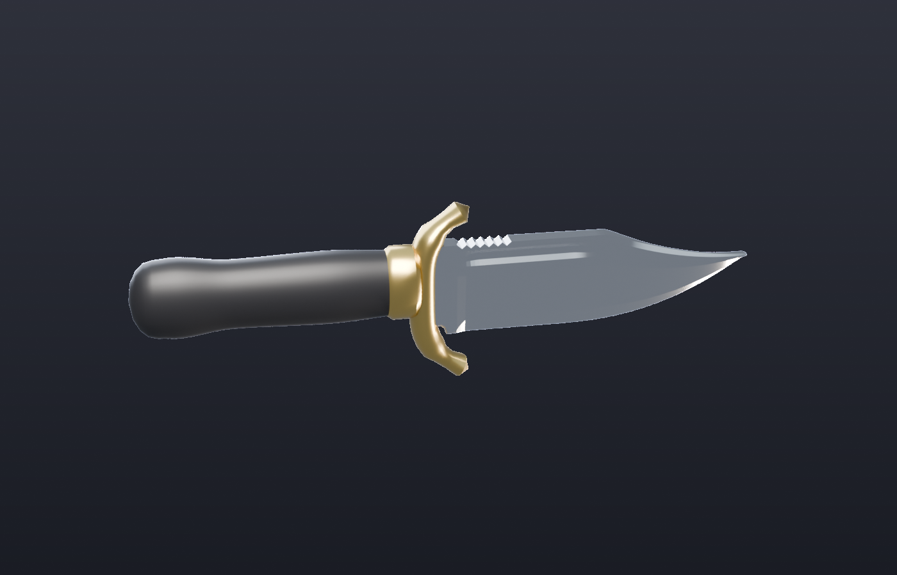

# Duel Knife (Roblox)



A Bowie-style knife for a Roblox duels game. It has a slim gold crescent guard with a gold collar and a straight, smooth black grip. The wide clip-point blade has:

- a sharpened false edge along the clip
- a fuller (groove) along the flat
- thumb notches (jimping) on the spine near the guard
- an unsharpened section (ricasso) with a plunge line where the grind starts
- a small notch (choil) at the start of the edge
- a bright cutting bevel along the edge

The model:

- **4,128 triangles** in total, well under Roblox's 20k-per-mesh limit.
- **About 2.8 studs long.** 1 Blender unit = 1 stud.
- **Three parts, one material each:** `Blade`, `Guard` (which includes the collar) and `Handle`. The grip part is named `Handle`, which is the name a Roblox `Tool` needs.

| File | What it is |
| --- | --- |
| `Knife.fbx` | The three parts as separate MeshParts. **Use this one.** |
| `Knife_Combined.fbx` | The same knife as a single mesh, if you want one MeshPart (for a display stand or a shop viewport, for example). |
| `Knife.blend` | Editable Blender scene. |
| `KnifeSetup.server.luau` | Welds the parts together and applies materials and colours in Roblox. |
| `build_knife.py` | Script that generates everything above. |

## Getting it into Roblox Studio

1. **Home → Import 3D**, then pick `Knife.fbx`. In the import settings, set **Scale Unit** to **Stud**. Check the sizes: `Blade` should be about 0.08 × 0.4 × 1.4 studs and `Handle` about 0.23 × 0.34 × 1.1.
2. Create a **Tool** in `StarterPack` and name it `Knife`. Move `Blade`, `Guard` and `Handle` from the imported model into the Tool, then delete the empty model.
3. Add a **Script** to the Tool and paste in `KnifeSetup.server.luau`. It welds the parts to `Handle` and sets materials, colours, `CanCollide = false` and `Massless = true`.
4. Press Play. The knife is held by the grip with the blade pointing forward and the edge facing down. To angle it differently, for example blade up or reverse grip, edit `Tool.Grip` or use a tool grip editor plugin.

The model faces the part's LookVector (-Z) with Y up. That is why the default `Tool.Grip` holds it pointing forward.

## Changing the design

All proportions are constants at the top of `build_knife.py`, for example `BLADE_LEN`, `SPINE_Z`, `EDGE_Z`, `CLIP_START`, `FULLER`, `JIMPING`, `CHOIL`, `HANDLE_*` and `GUARD_*`. Colours are set in `main()`. To rebuild everything, run either of these:

```bash
pip install bpy          # Blender as a Python module (needs Python 3.13)
python build_knife.py

# or with an installed Blender:
blender --background --python build_knife.py
```

Each part is UV-unwrapped, so you can paint a texture in Blender and apply it as a `SurfaceAppearance` or `TextureID` on the MeshPart.
