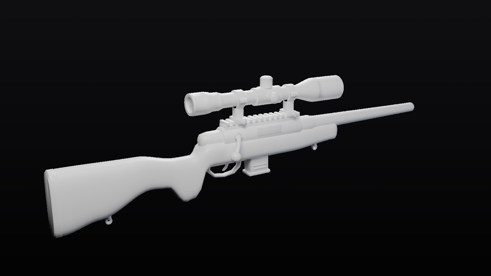

# Sniper (Roblox)



A plain white bolt-action sniper rifle for a Roblox sniper duels game, made to be the base for skins.

It has:

- a sporter stock with a raised comb, pistol grip, butt pad and sling studs
- a round receiver with an ejection port and a rail with cross slots on top
- a bolt with a ball knob
- a detachable box magazine
- a trigger and trigger guard
- a tapered barrel with a recessed muzzle
- a scope on two clamp rings: knurled eyepiece and power ring, elevation, windage and side-focus turrets, and an objective bell with lenses

Everything is plain white so any skin can go on top.

The model:

- **14,824 triangles** in total, under Roblox's 20k-per-mesh limit.
- **About 5 studs long.** 1 Blender unit = 1 stud.
- **UV-unwrapped**, so a skin is just a texture.

| File | What it is |
| --- | --- |
| `Sniper.fbx` | The whole rifle as **one MeshPart named `Handle`**, with a single UV layout. One texture = one skin. **Use this one.** |
| `Sniper_UV_Template.png` | The UV layout of `Sniper.fbx` (2048 × 2048). Paint skins on top of it. |
| `Sniper_Parts.fbx` | The same rifle as 11 separate parts (`Handle` is the stock, plus `Buttpad`, `Receiver`, `Rail`, `Bolt`, `Barrel`, `Magazine`, `TriggerGuard`, `Scope`, `Lens`, `ScopeMounts`), each with its own UVs. Use this if you want skins that just recolour parts, for example a gold scope or a black barrel. |
| `SniperSetup.server.luau` | Tool script: puts the hand on the pistol grip, makes the rifle white, and welds the parts if you use `Sniper_Parts.fbx`. |
| `Sniper.blend` | Editable Blender scene. |
| `build_sniper.py` | Script that generates everything above. |

## Getting it into Roblox Studio

1. **Home → Import 3D**, then pick `Sniper.fbx`. In the import settings, set **Scale Unit** to **Stud**. The rifle should come in about 4.95 studs long.
2. Create a **Tool** in `StarterPack` and name it `Sniper`. Move the imported `Handle` MeshPart into it.
3. Add a **Script** to the Tool and paste in `SniperSetup.server.luau`.
4. Press Play. The hand should hold the pistol grip with the barrel pointing forward. If the angle or position is off, adjust `GRIP_SINGLE` in the script, or use a tool grip editor plugin.

## Making skins

**Texture skins (`Sniper.fbx`):**

1. Open `Sniper_UV_Template.png` in any image editor. Paint or place stickers on a layer above it, then hide the template layer and export a PNG.
2. In Studio, add a **SurfaceAppearance** to `Handle` and set its `ColorMap` to your image. You can also set `MeshPart.TextureID`.
3. Each skin is one image. To switch skins in game, swap the `ColorMap`, or keep a few `SurfaceAppearance` presets and clone the one you want into `Handle`.

The two big islands at the bottom left of the template are the left and right sides of the stock. Those are the best places for stickers and logos. The scope tube and the barrel are the long strips.

For painting directly on the 3D model, open `Sniper.blend` in Blender (Texture Paint mode) or bring the FBX into a 3D painting app like Substance Painter.

**Colour skins (`Sniper_Parts.fbx`):** set `Color` and `Material` per part, for example a black `Scope` and `Barrel` with a white `Handle`. Remove the colour lines from the setup script if you do this, since the script makes everything white.

## Changing the design

The layout is in constants at the top of `build_sniper.py`, for example `BARREL_END_Y`, `SCOPE_Z`, `STOCK_TOP`, `STOCK_BOTTOM` and `STOCK_HALF_WIDTH`. Each part has its own `build_*` function. Running the script regenerates the FBX files, the UV template and the setup script's grip values:

```bash
pip install bpy          # Blender as a Python module (needs Python 3.13)
python build_sniper.py

# or with an installed Blender:
blender --background --python build_sniper.py
```
